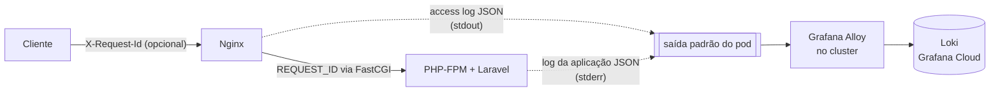

# Observabilidade da API — logs estruturados e correlação

Esta é a documentação da **fase 2** do plano de observabilidade do projeto. O plano completo,
com a escolha do Grafana Cloud e as fases 0 a 6, está no
[ADR-0002 do `infra-k8s`](https://github.com/FIAP-TC/infra-k8s/blob/main/docs/adr/0002-observabilidade-com-grafana-cloud.md);
as decisões desta fase, e as alternativas descartadas, estão em
[`docs/adr/0002-logs-estruturados-e-correlacao.md`](adr/0002-logs-estruturados-e-correlacao.md).

- [O caminho de um log](#o-caminho-de-um-log)
- [As duas linhas de cada requisição](#as-duas-linhas-de-cada-requisição)
- [Correlação: o X-Request-Id](#correlação-o-x-request-id)
- [O que nunca vai para o log](#o-que-nunca-vai-para-o-log)
- [Como ler os logs](#como-ler-os-logs)
- [Registrando um evento novo](#registrando-um-evento-novo)
- [Onde cada peça fica](#onde-cada-peça-fica)
- [Limites conhecidos](#limites-conhecidos)

## O caminho de um log



Nada é gravado em arquivo. O agente de observabilidade instalado na fase 1 lê o que o
Kubernetes grava a partir da **saída padrão dos containers**, então é para lá que os dois
logs vão:

- o Nginx escreve o access log em `/dev/stdout`;
- a aplicação escreve em `php://stderr`, e o PHP-FPM repassa a saída do processo filho sem
  acrescentar prefixo (é o que mantém a linha como JSON válido).

## As duas linhas de cada requisição

Elas não são redundantes: cada uma sabe algo que a outra não sabe.

### Linha do Nginx — latência vista de fora

```json
{"timestamp":"2026-11-01T18:42:03+00:00","level":"info","channel":"nginx","event":"http_access","request_id":"8f14e45fceea167a5a36dedd4bea2543","method":"GET","path":"/api/customers/42","status":"200","duration_seconds":"0.041","upstream_seconds":"0.038","bytes_sent":"312","client_ip":"10.0.17.7","forwarded_for":"187.1.2.3","referer":"","user_agent":"curl/8.7.1"}
```

| Campo | O que é |
|---|---|
| `duration_seconds` | tempo total da requisição, **do ponto de vista do cliente**: inclui rede, fila do PHP-FPM e envio da resposta |
| `upstream_seconds` | quanto desse tempo o PHP-FPM levou. A diferença entre os dois é fila/rede. Vazio quando a requisição não chegou ao PHP |
| `status` | código HTTP. É texto, não número: vale `"000"` quando o cliente desiste antes da resposta, e `000` não é número JSON válido |
| `client_ip` | quem abriu a conexão. Atrás do load balancer da AWS, é o IP do próprio balanceador |
| `forwarded_for` | o `X-Forwarded-For`, onde está o IP real do cliente |
| `bytes_sent` | tamanho do corpo da resposta |

### Linha da aplicação — contexto de dentro

```json
{"timestamp":"2026-11-01T18:42:03.512+00:00","level":"info","channel":"api","message":"GET /api/customers/42 200","service":"mecanica","env":"production","request_id":"8f14e45fceea167a5a36dedd4bea2543","event":"http_request","method":"GET","path":"/api/customers/42","route":"api/customers/{id}","status":200,"duration_ms":37.4,"client_ip":"10.0.17.7","user_agent":"curl/8.7.1","user_id":1}
```

| Campo | O que é |
|---|---|
| `route` | **o padrão da rota**, não o caminho concreto. É o que permite agregar latência por endpoint: com `/api/customers/42` cada id viraria uma série separada no dashboard |
| `duration_ms` | tempo dentro do Laravel, contado desde o início do boot do framework |
| `user_id` | usuário autenticado pelo JWT, quando existe |
| `event` | o tipo do registro. Toda linha estruturada tem um (ver [Registrando um evento novo](#registrando-um-evento-novo)) |
| `level` | `error` (5xx), `warning` (4xx) ou `info`. O Nginx usa a mesma regra, então uma consulta de erros serve para as duas fontes |
| `service`, `env` | de qual aplicação e de qual ambiente a linha veio |

Os campos têm os **mesmos nomes** nas duas fontes quando significam a mesma coisa. Isso é de
propósito: a linha é JSON plano, sem aninhamento, justamente para `| json` no Grafana
produzir o mesmo nome de campo nos dois casos.

Toda linha de log da aplicação — não só a da requisição — sai com `timestamp`, `level`,
`channel`, `message`, `service`, `env` e `request_id`.

## Correlação: o X-Request-Id

```
Cliente → Nginx:  (sem cabeçalho, ou X-Request-Id: pedido-do-parceiro-123)
                  o Nginx valida o formato; se não serve, gera um identificador
Nginx  → PHP:     REQUEST_ID=...        (parâmetro FastCGI)
PHP    → log:     request_id=...        (em todas as linhas daquela requisição)
PHP    → Cliente: X-Request-Id: ...     (cabeçalho da resposta)
```

O formato aceito é de 8 a 64 caracteres `A-Z a-z 0-9 _ . : -`. Ele é validado nos dois
lados, e os dois precisam concordar:

- no Nginx, pelo `map $http_x_request_id` em `docker/nginx/sites-enabled/laravel.conf`;
- na aplicação, pela constante `PATTERN` em `RequestIdMiddleware`.

Por que validar: o valor vem de fora e termina dentro de um log. Sem validação, um cliente
poderia mandar um "identificador" com aspas e vírgulas e forjar campos na linha de JSON.

Na prática, para investigar um erro relatado por um cliente:

1. peça o valor do cabeçalho `X-Request-Id` da resposta que deu erro;
2. no Grafana, filtre por `request_id` — virão as linhas do Nginx e da aplicação, em ordem.

## O que nunca vai para o log

| O que | Por quê |
|---|---|
| Corpo da requisição | é onde estão CPF, e-mail e senha; não há caso de uso que justifique o risco |
| Query string | carrega o token de aprovação da ordem de serviço (`GET /api/service-orders/approve?token=...`). O Nginx registra só o caminho, antes do `?` |
| Senha, token, chave (`password`, `token`, `authorization`, `jwt`, `secret`, `api_key`...) | substituídos por `[REDACTED]`, pelo nome do campo, em qualquer profundidade |
| CPF e CNPJ | ficam `***.***.***-01` e `**.***.***/****-34`. Pegos pelo nome do campo (`cpf`, `identification_number`) **e** pelo formato, em qualquer texto |
| E-mail | fica `j***@exemplo.com` |
| Token JWT em texto | fica `[REDACTED_JWT]` |
| Argumentos das chamadas no stack trace | o trace guarda só arquivo e linha, que é o que interessa para investigar |
| Requisições a `/nginx_status` | são as probes do Kubernetes, a cada 10 segundos em cada pod: seriam o "endpoint" mais acessado da API e gastariam a cota de ingestão com ruído |

O mascaramento acontece **na origem**, antes de a linha ser escrita, e não no Grafana: é a
única forma de o dado pessoal nunca sair do processo. São duas camadas, porque uma só não
alcança tudo:

1. `MaskSensitiveDataProcessor` — olha o **nome** do campo, enquanto o registro ainda é um
   array PHP. É o que pega `['password' => '...']` mesmo com valor sem formato reconhecível.
2. `JsonLineFormatter` — olha o **formato** do valor, na linha de JSON já pronta. É o que
   pega um CPF solto na mensagem de uma exceção, onde não existe nome de campo nenhum.

## Como ler os logs

### No ambiente local (Docker Compose)

```bash
docker compose logs -f api      # log da aplicação
docker compose logs -f nginx    # access log
```

As duas saídas são JSON. Para ler confortavelmente, passe pelo `jq`:

```bash
docker compose logs -f --no-log-prefix api | jq -c '{timestamp,level,event,route,status,duration_ms,request_id}'
```

Só erros:

```bash
docker compose logs --no-log-prefix api | jq -c 'select(.level=="error")'
```

> O canal de log vem do `.env` (`LOG_CHANNEL=json`). Se o seu `.env` é antigo e ainda tem
> `LOG_CHANNEL=stack`, a aplicação volta a gravar em `storage/logs/laravel.log` e nada
> aparece no `docker compose logs`.

### No cluster

```bash
kubectl logs -n fiap-tc-1 deployment/api --tail=20
kubectl logs -n fiap-tc-1 deployment/nginx --tail=20

# acompanhando e filtrando uma requisição específica
kubectl logs -n fiap-tc-1 deployment/api -f | grep 8f14e45fceea167a5a36dedd4bea2543
```

### No Grafana Cloud (LogQL)

Em **Explore**, escolhendo a fonte de dados Loki e o modo **Code**:

```logql
# tudo o que aconteceu em uma requisição, nas duas fontes
{namespace="fiap-tc-1"} | json | request_id = "8f14e45fceea167a5a36dedd4bea2543"

# erros da aplicação na última hora
{namespace="fiap-tc-1", container="api"} | json | level = "error"

# as requisições mais lentas (acima de 500 ms)
{namespace="fiap-tc-1", container="api"} | json | event = "http_request" | duration_ms > 500

# latência p95 por rota, em milissegundos
quantile_over_time(0.95,
  {namespace="fiap-tc-1", container="api"} | json | event = "http_request"
  | unwrap duration_ms [5m]
) by (route)

# requisições por minuto, por status
sum by (status) (
  count_over_time({namespace="fiap-tc-1", container="nginx"} | json [1m])
)
```

Os rótulos (`namespace`, `container`, `pod`) são os que o agente da fase 1 aplica. Para ver
a lista exata disponível na sua stack, use o **Label browser** do Explore.

## Registrando um evento novo

A convenção é: **toda linha estruturada tem um campo `event`**, e os dados vão no contexto,
não interpolados na mensagem. Assim o campo pode ser filtrado e agregado.

```php
use Illuminate\Support\Facades\Log;

Log::info('Ordem de serviço aprovada', [
    'event' => 'service_order_approved',
    'service_order_id' => $order->getId(),
    'total' => $order->getTotal(),
]);
```

Isso vira:

```json
{"timestamp":"...","level":"info","channel":"api","message":"Ordem de serviço aprovada","service":"mecanica","env":"production","request_id":"...","event":"service_order_approved","service_order_id":42,"total":1250.0}
```

Três cuidados:

- **Não** escreva `Log::info("OS {$id} aprovada")`. A mensagem interpolada não é filtrável:
  cada id gera um texto diferente.
- Os nomes `timestamp`, `level`, `channel` e `message` são reservados pela linha; se vierem
  no contexto, são descartados.
- Dados pessoais podem ir no contexto: o mascaramento é automático. Mas o melhor é não
  precisar deles — prefira o id a um nome ou documento.

É esta convenção que a **fase 4** (eventos de negócio da ordem de serviço e alertas) vai usar.

## Onde cada peça fica

| Arquivo | Papel |
|---|---|
| `config/logging.php` | declara o canal `json`, que é o padrão em todos os ambientes |
| `app/Infrastructure/Observability/Logging/JsonLoggerFactory.php` | monta o canal: stderr + formatador + processadores |
| `.../Logging/JsonLineFormatter.php` | achata o registro em uma linha de JSON e mascara por formato |
| `.../Logging/MaskSensitiveDataProcessor.php` | mascara pelo nome do campo |
| `.../Logging/SensitiveDataMasker.php` | as regras de mascaramento (campos e formatos), usadas pelas duas camadas |
| `.../Logging/RequestContextProcessor.php` | acrescenta `request_id`, `service` e `env` a toda linha |
| `app/Infrastructure/Observability/RequestContext.php` | guarda o identificador e o início da requisição |
| `app/Interfaces/Http/Middleware/RequestIdMiddleware.php` | define o identificador e devolve no cabeçalho da resposta |
| `app/Interfaces/Http/Middleware/RequestLoggerMiddleware.php` | registra a linha `http_request`, depois da resposta |
| `docker/nginx/sites-enabled/laravel.conf` | access log em JSON, identificador de correlação, `/nginx_status` fora do log |
| `k8s/base/nginx/` | **cópia idêntica** da configuração do Nginx, que vira ConfigMap no cluster |
| `docker/php-fmp/zz-tuning.conf` | garante que a saída do processo filho chegue limpa ao stdout do container |

A configuração do Nginx existe em duas cópias (o Docker Compose monta arquivo, o Kubernetes
precisa de ConfigMap, e o kustomize não lê arquivo de fora da própria pasta). O pipeline
compara as duas com `diff` e falha se divergirem, então a duplicação não passa batida.

## Limites conhecidos

- **Falso positivo no mascaramento:** um celular com DDD também tem 11 dígitos e será
  mascarado como se fosse CPF. Aceitável, já que telefone também é dado pessoal.
- **`client_ip` atrás do load balancer** é o IP do balanceador, não o do cliente; o IP real
  está em `forwarded_for`. A aplicação não confia no `X-Forwarded-For` (o `TrustProxies` está
  sem proxies configurados), de propósito: confiar nesse cabeçalho sem restringir a origem
  permite falsificar o IP de origem.
- **Duas linhas por requisição.** É o custo de ter latência de fora e contexto de dentro. As
  probes e o access log do PHP-FPM saíram do caminho em troca.
- **`APP_DEBUG=true` no ConfigMap do cluster.** Não é assunto desta fase, mas vale registrar:
  com depuração ligada, uma exceção devolve o stack trace **na resposta HTTP**, e o
  mascaramento aqui só cobre o log. Mudar para `false` é recomendado.
- **Nada de métricas ainda.** Latência e contagem são calculadas a partir dos logs, que é o
  que a fase 2 entrega. Health check e probes de HTTP são a fase 3; dashboards prontos, a
  fase 5.
