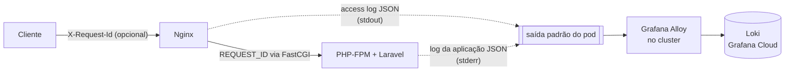

# Observabilidade da API — logs estruturados, correlação e sondas de saúde

Esta é a documentação das **fases 2 e 3** do plano de observabilidade do projeto. O plano
completo, com a escolha do Grafana Cloud e as fases 0 a 6, está no
[ADR-0002 do `infra-k8s`](https://github.com/FIAP-TC/infra-k8s/blob/main/docs/adr/0002-observabilidade-com-grafana-cloud.md);
as decisões de cada fase, e as alternativas descartadas, estão em
[`adr/0002-logs-estruturados-e-correlacao.md`](adr/0002-logs-estruturados-e-correlacao.md) e
[`adr/0003-sondas-de-saude-e-probes.md`](adr/0003-sondas-de-saude-e-probes.md).

- [O caminho de um log](#o-caminho-de-um-log)
- [As duas linhas de cada requisição](#as-duas-linhas-de-cada-requisição)
- [Correlação: o X-Request-Id](#correlação-o-x-request-id)
- [O que nunca vai para o log](#o-que-nunca-vai-para-o-log)
- [Sondas de saúde](#sondas-de-saúde)
- [Como ler os logs](#como-ler-os-logs)
- [Registrando um evento novo](#registrando-um-evento-novo)
  - [Os eventos de negócio da ordem de serviço](#os-eventos-de-negócio-da-ordem-de-serviço)
- [Onde cada peça fica](#onde-cada-peça-fica)
- [Limites conhecidos](#limites-conhecidos)

## O caminho de um log



Nada é gravado em arquivo. O agente de observabilidade instalado na fase 1 lê o que o
Kubernetes grava a partir da **saída padrão dos containers**, então é para lá que os dois
logs vão:

- o Nginx escreve o access log em `/dev/stdout`;
- a aplicação escreve em `php://stderr`, e o PHP-FPM repassa a saída do processo filho sem
  acrescentar prefixo (é o que mantém a linha como JSON válido).

## As duas linhas de cada requisição

Elas não são redundantes: cada uma sabe algo que a outra não sabe.

### Linha do Nginx — latência vista de fora

```json
{"timestamp":"2026-11-01T18:42:03+00:00","level":"info","channel":"nginx","event":"http_access","request_id":"8f14e45fceea167a5a36dedd4bea2543","method":"GET","path":"/api/customers/42","status":"200","duration_seconds":"0.041","upstream_seconds":"0.038","bytes_sent":"312","client_ip":"10.0.17.7","forwarded_for":"187.1.2.3","referer":"","user_agent":"curl/8.7.1"}
```

| Campo | O que é |
|---|---|
| `duration_seconds` | tempo total da requisição, **do ponto de vista do cliente**: inclui rede, fila do PHP-FPM e envio da resposta |
| `upstream_seconds` | quanto desse tempo o PHP-FPM levou. A diferença entre os dois é fila/rede. Vazio quando a requisição não chegou ao PHP |
| `status` | código HTTP. É texto, não número: vale `"000"` quando o cliente desiste antes da resposta, e `000` não é número JSON válido |
| `client_ip` | quem abriu a conexão. Atrás do load balancer da AWS, é o IP do próprio balanceador |
| `forwarded_for` | o `X-Forwarded-For`, onde está o IP real do cliente |
| `bytes_sent` | tamanho do corpo da resposta |

### Linha da aplicação — contexto de dentro

```json
{"timestamp":"2026-11-01T18:42:03.512+00:00","level":"info","channel":"api","message":"GET /api/customers/42 200","service":"mecanica","env":"production","request_id":"8f14e45fceea167a5a36dedd4bea2543","event":"http_request","method":"GET","path":"/api/customers/42","route":"api/customers/{id}","status":200,"duration_ms":37.4,"client_ip":"10.0.17.7","user_agent":"curl/8.7.1","user_id":1}
```

| Campo | O que é |
|---|---|
| `route` | **o padrão da rota**, não o caminho concreto. É o que permite agregar latência por endpoint: com `/api/customers/42` cada id viraria uma série separada no dashboard. Vale `unmatched` quando a requisição não casou com rota nenhuma (um 404) — um valor explícito, e não `null`, para a série não sair sem nome no gráfico |
| `duration_ms` | tempo dentro do Laravel, contado desde o início do boot do framework |
| `user_id` | usuário autenticado pelo JWT, quando existe |
| `event` | o tipo do registro. Toda linha estruturada tem um (ver [Registrando um evento novo](#registrando-um-evento-novo)) |
| `level` | `error` (5xx), `warning` (4xx) ou `info`. O Nginx usa a mesma regra, então uma consulta de erros serve para as duas fontes |
| `service`, `env` | de qual aplicação e de qual ambiente a linha veio |

Os campos têm os **mesmos nomes** nas duas fontes quando significam a mesma coisa. Isso é de
propósito: a linha é JSON plano, sem aninhamento, justamente para `| json` no Grafana
produzir o mesmo nome de campo nos dois casos.

Toda linha de log da aplicação — não só a da requisição — sai com `timestamp`, `level`,
`channel`, `message`, `service`, `env` e `request_id`.

## Correlação: o X-Request-Id

```
Cliente → Nginx:  (sem cabeçalho, ou X-Request-Id: pedido-do-parceiro-123)
                  o Nginx valida o formato; se não serve, gera um identificador
Nginx  → PHP:     REQUEST_ID=...        (parâmetro FastCGI)
PHP    → log:     request_id=...        (em todas as linhas daquela requisição)
PHP    → Cliente: X-Request-Id: ...     (cabeçalho da resposta)
```

O formato aceito é de 8 a 64 caracteres `A-Z a-z 0-9 _ . : -`. Ele é validado nos dois
lados, e os dois precisam concordar:

- no Nginx, pelo `map $http_x_request_id` em `docker/nginx/sites-enabled/laravel.conf`;
- na aplicação, pela constante `PATTERN` em `RequestIdMiddleware`.

Por que validar: o valor vem de fora e termina dentro de um log. Sem validação, um cliente
poderia mandar um "identificador" com aspas e vírgulas e forjar campos na linha de JSON.

Na prática, para investigar um erro relatado por um cliente:

1. peça o valor do cabeçalho `X-Request-Id` da resposta que deu erro;
2. no Grafana, filtre por `request_id` — virão as linhas do Nginx e da aplicação, em ordem.

## O que nunca vai para o log

| O que | Por quê |
|---|---|
| Corpo da requisição | é onde estão CPF, e-mail e senha; não há caso de uso que justifique o risco |
| Query string | carrega o token de aprovação da ordem de serviço (`GET /api/service-orders/approve?token=...`). O Nginx registra só o caminho, antes do `?` — **no access log**; o log de erro dele é exceção, ver [Limites conhecidos](#limites-conhecidos) |
| Senha, token, chave (`password`, `token`, `authorization`, `jwt`, `secret`, `api_key`...) | substituídos por `[REDACTED]`, pelo nome do campo, em qualquer profundidade |
| CPF e CNPJ | ficam `***.***.***-01` e `**.***.***/****-34`. Pegos pelo nome do campo (`cpf`, `identification_number`) **e** pelo formato, em qualquer texto |
| E-mail | fica `j***@exemplo.com` |
| Token JWT em texto | fica `[REDACTED_JWT]` |
| Argumentos das chamadas no stack trace | o trace guarda só arquivo e linha, que é o que interessa para investigar |
| Requisições a `/nginx_status` | são as probes do Kubernetes, a cada 10 segundos em cada pod: seriam o "endpoint" mais acessado da API e gastariam a cota de ingestão com ruído |
| Sondas de saúde que **passaram** | mesmo motivo. A que **falha** é registrada, porque é raro e é aí que a linha vale |

O mascaramento acontece **na origem**, antes de a linha ser escrita, e não no Grafana: é a
única forma de o dado pessoal nunca sair do processo. São duas camadas, porque uma só não
alcança tudo:

1. `MaskSensitiveDataProcessor` — olha o **nome** do campo, enquanto o registro ainda é um
   array PHP. É o que pega `['password' => '...']` mesmo com valor sem formato reconhecível.
2. `JsonLineFormatter` — olha o **formato** do valor, na linha de JSON já pronta. É o que
   pega um CPF solto na mensagem de uma exceção, onde não existe nome de campo nenhum.

## Sondas de saúde

Duas rotas, sem autenticação, usadas pelas probes do Kubernetes e pelo monitoramento
sintético. **Elas respondem a perguntas diferentes, e é isso que importa:**

| Rota | Pergunta | Checa banco? | Falha significa |
|---|---|---|---|
| `GET /api/health` | este processo travou? | **não** | o Kubernetes **reinicia** o pod |
| `GET /api/health/ready` | este pod consegue atender agora? | sim (`SELECT 1`) | o pod **sai do balanceamento**, sem reiniciar |

A sonda de vida não toca no banco de propósito. Se tocasse, uma queda do RDS faria o
Kubernetes reiniciar **todos** os pods da API em laço — reiniciar não conserta um banco
remoto, e cada pod novo ainda paga o custo de subir o framework do zero, atrasando a
recuperação quando o banco volta. Dependência externa é assunto da prontidão, que tira o pod
do tráfego e o devolve sozinho quando a dependência responde.

```bash
curl -s http://localhost/api/health        # {"status":"ok"}
curl -s http://localhost/api/health/ready  # {"status":"ok","checks":{"database":true}}
```

Com o banco fora, a prontidão responde **503**:

```json
{"status":"unavailable","checks":{"database":false}}
```

O corpo diz qual checagem falhou, nunca a mensagem do driver — que traz host, usuário e porta.
Esse detalhe fica no log, mascarado.

### Por que as probes da API usam `exec` e não `httpGet`

O container da API fala **FastCGI** na porta 9000, não HTTP: uma probe `httpGet` não consegue
conversar com ele. Era por isso que as probes aqui eram `tcpSocket` — que só confirma que
alguém aceita conexão na porta, e continua passando com o PHP incapaz de executar qualquer
coisa.

A imagem traz o `cgi-fcgi` (pacote `fcgi`, 131 KiB), um cliente FastCGI de linha de comando.
A probe monta a requisição e fala o protocolo certo, exercitando PHP e Laravel de verdade:

```bash
REQUEST_METHOD=GET SCRIPT_NAME=/index.php \
  SCRIPT_FILENAME=/var/www/public/index.php \
  REQUEST_URI=/api/health/ready DOCUMENT_ROOT=/var/www/public \
  cgi-fcgi -bind -connect 127.0.0.1:9000 | grep -q '"status":"ok"'
```

O `grep` não é enfeite: o `cgi-fcgi` sai com código 0 **mesmo quando a aplicação responde
503**, então quem decide se a sonda passou é o corpo da resposta.

O Nginx continua com probe que olha só o Nginx. Se ele ficasse "não pronto" porque a API caiu,
seus pods sairiam do Service, o LoadBalancer ficaria sem destino e o cliente receberia falha
de conexão — pior que um 502, que ao menos diz o que aconteceu.

## Como ler os logs

### No ambiente local (Docker Compose)

```bash
docker compose logs -f api      # log da aplicação
docker compose logs -f nginx    # access log
```

As duas saídas são JSON. Para ler confortavelmente, passe pelo `jq`:

```bash
docker compose logs -f --no-log-prefix api | jq -c '{timestamp,level,event,route,status,duration_ms,request_id}'
```

Só erros:

```bash
docker compose logs --no-log-prefix api | jq -c 'select(.level=="error")'
```

> O canal de log vem do `.env` (`LOG_CHANNEL=json`). Se o seu `.env` é antigo e ainda tem
> `LOG_CHANNEL=stack`, a aplicação volta a gravar em `storage/logs/laravel.log` e nada
> aparece no `docker compose logs`.

### No cluster

```bash
kubectl logs -n fiap-tc-1 deployment/api --tail=20
kubectl logs -n fiap-tc-1 deployment/nginx --tail=20

# acompanhando e filtrando uma requisição específica
kubectl logs -n fiap-tc-1 deployment/api -f | grep 8f14e45fceea167a5a36dedd4bea2543
```

### No Grafana Cloud (LogQL)

Em **Explore**, escolhendo a fonte de dados Loki e o modo **Code**:

```logql
# tudo o que aconteceu em uma requisição, nas duas fontes
{namespace="fiap-tc-1"} | json | request_id = "8f14e45fceea167a5a36dedd4bea2543"

# erros da aplicação na última hora
{namespace="fiap-tc-1", container="api"} | json | level = "error"

# as requisições mais lentas (acima de 500 ms)
{namespace="fiap-tc-1", container="api"} | json | event = "http_request" | duration_ms > 500

# latência p95 por rota, em milissegundos
quantile_over_time(0.95,
  {namespace="fiap-tc-1", container="api"} | json | event = "http_request"
  | unwrap duration_ms [5m]
) by (route)

# requisições por minuto, por status
sum by (status) (
  count_over_time({namespace="fiap-tc-1", container="nginx"} | json [1m])
)
```

Os rótulos (`namespace`, `container`, `pod`) são os que o agente da fase 1 aplica. Para ver
a lista exata disponível na sua stack, use o **Label browser** do Explore.

## Registrando um evento novo

A convenção é: **toda linha estruturada tem um campo `event`**, e os dados vão no contexto,
não interpolados na mensagem. Assim o campo pode ser filtrado e agregado.

```php
use Illuminate\Support\Facades\Log;

Log::info('Ordem de serviço aprovada', [
    'event' => 'service_order_approved',
    'service_order_id' => $order->getId(),
    'total' => $order->getTotal(),
]);
```

Isso vira:

```json
{"timestamp":"...","level":"info","channel":"api","message":"Ordem de serviço aprovada","service":"mecanica","env":"production","request_id":"...","event":"service_order_approved","service_order_id":42,"total":1250.0}
```

Três cuidados:

- **Não** escreva `Log::info("OS {$id} aprovada")`. A mensagem interpolada não é filtrável:
  cada id gera um texto diferente.
- Os nomes `timestamp`, `level`, `channel` e `message` são reservados pela linha; se vierem
  no contexto, são descartados.
- Dados pessoais podem ir no contexto: o mascaramento é automático. Mas o melhor é não
  precisar deles — prefira o id a um nome ou documento.

### Os eventos de negócio da ordem de serviço

Os eventos da OS não são escritos com `Log::info` solto: eles ficam em
[`ServiceOrderEvents`](../app/Infrastructure/Observability/ServiceOrderEvents.php), uma classe
só com métodos tipados. Dois motivos:

1. **Os nomes são contrato.** Painel e alerta no Grafana filtram por
   `event="service_order_status_changed"`. Um erro de digitação num caso de uso não quebra
   teste nenhum — só faz um painel parar de contar, em silêncio.
2. **O Grafana Cloud não alcança o RDS** (o banco só aceita conexão de dentro da VPC). Os
   painéis de negócio são calculados a partir destes eventos, não de SQL: **o log é a fonte
   de dados do dashboard.**

| Evento | Quando | Campos próprios |
|---|---|---|
| `service_order_created` | ordem aberta | `service_order_id`, `order_value` |
| `service_order_status_changed` | a cada mudança de status | `status`, `status_id`, `time_average_minutes` |
| `service_order_approval_requested` | e-mail de aprovação enviado | `customer_id` |
| `service_order_approval_request_failed` | falha ao enviar (nível `error`) | `customer_id`, `failure_class` |
| `service_order_approved_by_customer` | cliente aprovou | `customer_id` |
| `service_order_rejected_by_customer` | cliente reprovou | `customer_id` |

Três decisões que valem explicar:

- **O status vai por nome** (`aguardando_aprovacao`), não só por id. Um painel de "tempo médio
  por status" com a legenda "3" não diz nada. O mapa está em
  `ServiceOrderEntity::STATUS_NAMES`, e há teste garantindo que todo status do domínio tem
  nome — sem ele, um status novo apareceria como `desconhecido` no Grafana.
- **O evento sai depois do commit**, nunca de dentro da transação. Um evento emitido dentro
  continuaria no log mesmo se a transação desfizesse tudo, e o painel contaria uma ordem que
  não existe.
- **Nenhum dado pessoal**, só identificadores internos. A falha de integração guarda a
  **classe** da exceção, não a mensagem: mensagem de erro de SMTP costuma trazer o e-mail do
  destinatário. Há teste cobrindo cada um desses pontos.

Consultas que estes eventos habilitam:

```logql
# volume diário de ordens abertas
sum(count_over_time({namespace="fiap-tc-1", container="api"} | json | event="service_order_created" [24h]))

# tempo médio por status
avg_over_time({namespace="fiap-tc-1", container="api"} | json | event="service_order_status_changed" | unwrap time_average_minutes [1h]) by (status)

# falhas de integração (base do alerta)
sum(count_over_time({namespace="fiap-tc-1", container="api"} | json | event="service_order_approval_request_failed" [5m]))
```

## Onde cada peça fica

| Arquivo | Papel |
|---|---|
| `config/logging.php` | declara o canal `json`, que é o padrão em todos os ambientes |
| `app/Infrastructure/Observability/Logging/JsonLoggerFactory.php` | monta o canal: stderr + formatador + processadores |
| `.../Logging/JsonLineFormatter.php` | achata o registro em uma linha de JSON e mascara por formato |
| `.../Logging/MaskSensitiveDataProcessor.php` | mascara pelo nome do campo |
| `.../Logging/SensitiveDataMasker.php` | as regras de mascaramento (campos e formatos), usadas pelas duas camadas |
| `.../Logging/RequestContextProcessor.php` | acrescenta `request_id`, `service` e `env` a toda linha |
| `app/Infrastructure/Observability/RequestContext.php` | guarda o identificador e o início da requisição |
| `app/Interfaces/Http/Middleware/RequestIdMiddleware.php` | define o identificador e devolve no cabeçalho da resposta |
| `app/Interfaces/Http/Middleware/RequestLoggerMiddleware.php` | registra a linha `http_request`, depois da resposta; deixa de fora a sonda que passou |
| `app/Interfaces/Http/Controllers/Health/LivenessController.php` | sonda de vida: só prova que o PHP executa e o Laravel sobe |
| `app/Interfaces/Http/Controllers/Health/ReadinessController.php` | sonda de prontidão: checa o banco e responde 503 se ele não responde |
| `app/Infrastructure/Observability/ServiceOrderEvents.php` | os eventos de negócio da OS, com os nomes que painel e alerta filtram |
| `k8s/base/06-api-deployment.yaml` | as probes por `exec` com `cgi-fcgi`, que falam FastCGI com a porta 9000 |
| `docker/php-fmp/Dockerfile` | instala o pacote `fcgi`, que traz o cliente usado pelas probes |
| `docker/nginx/sites-enabled/laravel.conf` | access log em JSON, identificador de correlação, `/nginx_status` fora do log |
| `k8s/base/nginx/` | **cópia idêntica** da configuração do Nginx, que vira ConfigMap no cluster |
| `docker/php-fmp/zz-tuning.conf` | garante que a saída do processo filho chegue limpa ao stdout do container |

A configuração do Nginx existe em duas cópias (o Docker Compose monta arquivo, o Kubernetes
precisa de ConfigMap, e o kustomize não lê arquivo de fora da própria pasta). O pipeline
compara as duas com `diff` e falha se divergirem, então a duplicação não passa batida.

## Limites conhecidos

- **Falso positivo no mascaramento:** um celular com DDD também tem 11 dígitos e será
  mascarado como se fosse CPF. Aceitável, já que telefone também é dado pessoal.
- **`client_ip` atrás do load balancer** é o IP do balanceador, não o do cliente; o IP real
  está em `forwarded_for`. A aplicação não confia no `X-Forwarded-For` (o `TrustProxies` está
  sem proxies configurados), de propósito: confiar nesse cabeçalho sem restringir a origem
  permite falsificar o IP de origem.
- **Duas linhas por requisição.** É o custo de ter latência de fora e contexto de dentro. As
  probes e o access log do PHP-FPM saíram do caminho em troca.
- **O log de erro do Nginx pode registrar a query string.** O access log registra só o
  caminho, mas o log de erro é outro: texto puro, formato do próprio Nginx, e cada linha
  inclui a requisição original — com query. Num teste no cluster, o aviso "an upstream
  response is buffered to a temporary file" levou o token de aprovação para o log. O nível do
  log de erro foi baixado para `error` e os buffers de FastCGI foram aumentados, então o aviso
  não acontece mais; mas uma linha de `[error]` de verdade continua carregando a query string.
  A correção definitiva é o token sair da query string (cabeçalho ou corpo), o que muda o
  contrato da API e está em aberto. Enquanto isso: **não coloque segredo em query string.**
- **`SELECT 1` não prova tudo.** Confirma que há conexão e que o servidor responde; não diz
  que as tabelas existem nem que as migrations rodaram.
- **O comando da probe é frágil a mudanças de caminho.** É uma linha de shell com variáveis de
  ambiente do CGI dentro do manifest; se `/var/www/public` mudar, as probes param de passar.
- **Nada de métricas ainda.** Latência e contagem são calculadas a partir dos logs, que é o
  que a fase 2 entrega. Eventos de negócio e alertas são a fase 4; dashboards prontos, a
  fase 5; rastros distribuídos, a fase 6.
- **Monitoramento sintético ainda não está ligado.** As sondas existem e têm endereço
  estável; falta criar o check no Grafana Cloud, que é configuração da conta.
